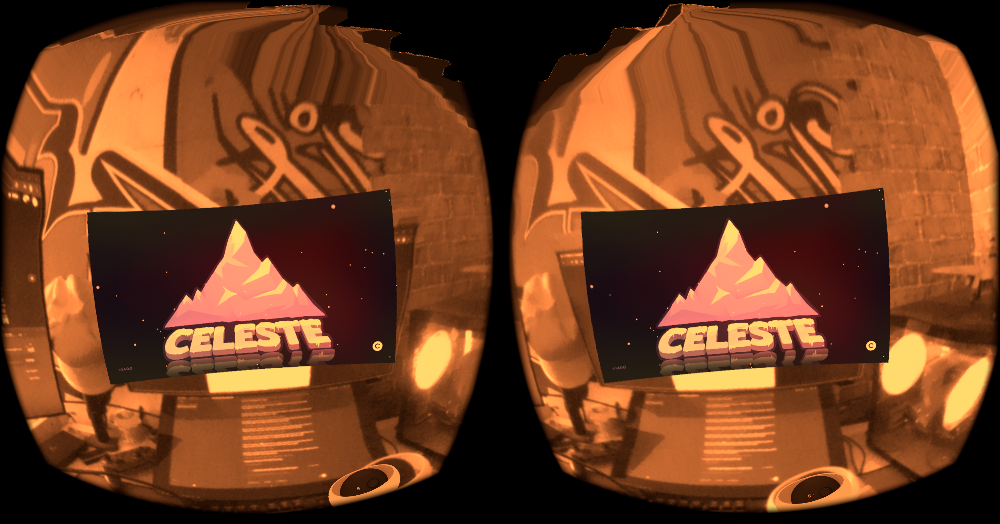
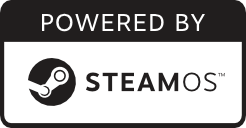
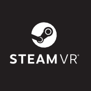

  <a href="https://github.com/amichyrpi/stearlight">
    <picture>
      <source media="(prefers-color-scheme: dark)" srcset="assets/stearlight_small_white.svg">
      
    </picture>
  </a>

<h1 align="center">Stearlight OS</h1>

<strong>Steam Frame OS Quest application</strong>

  Full Steam Frame OS port with Proton, FEX, streaming, and standalone capability all in one app.

  <a href="https://github.com/amichyrpi/stearlight/releases/tag/temp-build"><strong>Install Stearlight OS</strong></a>
  ·
  <a href="https://github.com/amichyrpi/stearlight#known-issues">Known issues</a>

  <a href="https://github.com/amichyrpi/stearlight">
    <picture>
      
    </picture>
  </a>

  <a href="https://github.com/amichyrpi/stearlight" style="display: inline-flex; align-items: center; gap: 40px;">
    <picture>
      <source media="(prefers-color-scheme: dark)" srcset="assets/steamos_powered_white.png">
      
    </picture>
    <picture>
      <source media="(prefers-color-scheme: dark)" srcset="assets/steamvr_white.png">
      
    </picture>
  </a>

## About

Stearlight is a Linux application for the Quest platform
that brings the full Steam Frame OS to the Quest.

It includes:

- ARM64 SteamVR with FEX and Proton
- Tracking support and passthrough
- VR streaming for VR and non-VR games with usb support
- Bluetooth support for sign-in
- Standalone capability for VR and non-VR games
- Desktop mode
- Hand tracking

## Known-issues

- [ ] Overall performance is really slow due to the emulation system.

## Performance

For a better VR experience, you will need to disable battery-saving
mode on your Quest. That means a smoother experience but shorter playtime.

## Setup and troubleshooting

See the [Quest setup guide](docs/quest-setup.md) for PC streaming, library
filters, Touch gamepad input, text readability, and Chromium diagnostics.

## Development

This project bundles a VM version of the OS and a Quest version of the OS.
The VM version is not maintained anymore, so the Quest
version is the only one maintained.

### Standalone gaming

Every game is different and therefore has different issues. In this
project, we have added patches for standalone gaming, but they are not perfect,
and some games still don't run. If you want to run a game and you have patched
the project for your game, your changes will be merged.

## Build the Quest APK

The **Quest APK** workflow builds the complete standalone application for
pull requests and pushes to `main`. Download the `stearlight-quest` artifact
from the workflow run to test a PR.

Successful builds on the default branch publish `stearlight-quest.apk`,
checksums and dependency sources to the [Continuous build](https://github.com/amichyrpi/stearlight/releases/tag/continuous).
Sideload the APK and open **Stearlight OS** from the Quest app library.
The APK includes its Linux rootfs, SteamVR, KDE, drivers and adapters.

See the [Quest build guide](packages/quest-runtime/README.md#building-the-apk)
for local build commands and continuous signing setup. The workflow uses
the pinned public Frame recovery and builds from repository sources; it
does not require files from a developer's PC or a signed-in Steam account.
VM build tools remain archived in the repository and are not built or
published by CI.

## Contribution

Before contributing to this project, please look at the [`Contribution guidelines`](CONTRIBUTING.md).

## License

Stearlight code is licensed under the **FSL-1.1-ALv2** license. Valve assets and intellectual property are owned by Valve themselves.
